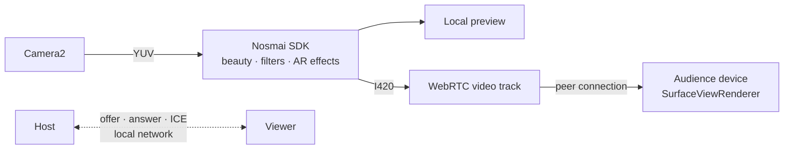

# Nosmai × WebRTC — Android Live Streaming Quickstart

A minimal Android sample that shows how to broadcast a live stream with **Nosmai** beauty, filters and AR effects over plain **WebRTC**.

Nosmai renders the effects on the host's device. Each processed frame is fed into a WebRTC video track, so viewers receive exactly what the host sees — no extra work is needed on the audience side.


## Features

- **Go live as a host** with the Nosmai effects pipeline
- **Watch as an audience member** on a second device
- **Beauty controls** — skin smoothing, whitening, face slimming, eye enlargement, sharpening
- **Cloud filters and AR effects** — browsed with thumbnails, downloaded on demand, applied in one tap
- **Front / back camera switch**
- **Live FPS counter** for both host (frames sent) and audience (frames rendered)
- **No streaming account or server needed** — the only key is your Nosmai license key

## How it works



1. On Android the app owns the camera. `Camera2Helper` opens it and passes every YUV frame to Nosmai.
2. Nosmai is initialised with your license key, renders the effects into its preview view, and returns each processed frame as I420.
3. The host creates a WebRTC video source without a camera capturer and hands it Nosmai's frames through the source's `capturerObserver`.
4. When a viewer appears, the host creates a peer connection, adds its video and audio tracks, and sends an offer. The viewer answers, and both sides exchange ICE candidates.
5. The viewer renders the host's video track.

### About signaling

WebRTC connects two peers directly, but it does not say how they find each other and exchange the offer, answer and ICE candidates. That part is called **signaling**, and every WebRTC app has to bring its own.

To keep this sample runnable without any server, signaling goes over the **local network** (`LocalSignaling.kt`): the host opens a TCP port and advertises it with Android's network service discovery (NSD); viewers on the same Wi-Fi find the service and connect. Messages are JSON objects, one per line. This means:

- **Both phones must be on the same Wi-Fi network.**
- No extra permission prompt is shown; the app only needs network access.
- This sample does not connect to the iOS quickstart, which uses Apple's MultipeerConnectivity for its signaling.

In your own app, replace `LocalSignaling` with your signaling channel (for example a WebSocket to your backend) and add a TURN server so that phones on different networks can connect. Nothing else in the sample depends on how the messages travel.

## Requirements

| | |
|---|---|
| Android Studio | A version that supports Android Gradle Plugin 8.9 (Meerkat or later) |
| JDK | 17 |
| Android | 7.0 (API 24) or later |
| Devices | Two physical Android phones (arm64-v8a or armeabi-v7a) on the same Wi-Fi — one to host, one to watch. Emulators are not supported. |
| Accounts | A Nosmai license key |

## Getting started

### 1. Clone and open

```sh
git clone https://github.com/HashirYamin-dev/quick-start-nosmai-webRTC-livestreaming-app-android.git
```

Open the folder in Android Studio and let Gradle sync. Both SDKs are downloaded by Gradle — WebRTC from Maven Central and the Nosmai SDK from its GitHub release — so there is nothing to add by hand.

### 2. Set your application ID

In `app/build.gradle.kts`, change `applicationId` to your own:

```kotlin
applicationId = "com.yourcompany.yourapp"
```

> **Important:** a Nosmai license key only works with the application ID it was issued for. Create your key for the same application ID you set here.

### 3. Add your Nosmai key

Create a license key for your application ID in the Nosmai dashboard, then open `app/src/main/java/com/nosmai/quickstart/webrtc/DemoConfig.kt` and replace the placeholder:

```kotlin
const val NOSMAI_LICENSE_KEY = "YOUR_NOSMAI_LICENSE_KEY"
const val ROOM_NAME = "demo-room"
```

| Value | Description |
|---|---|
| `NOSMAI_LICENSE_KEY` | Your Nosmai license key. |
| `ROOM_NAME` | Any room name. Host and audience must use the same one. |

### 4. Run

Connect both phones to the same Wi-Fi, then build and run on both, from Android Studio or with:

```sh
./gradlew installDebug
```

1. On the first phone tap **Go Live (Host)** and allow camera and microphone access.
2. On the second phone tap **Watch (Audience)**.
3. On the host, use the **Beauty**, **Filters** and **AR Effects** tabs — the audience sees the result in real time.

The audience can join before or after the host. If the host leaves and goes live again, viewers who stayed on the screen find it and reconnect automatically.

## Project structure

```
app/src/main/java/com/nosmai/quickstart/webrtc/
├── DemoConfig.kt       Your Nosmai key and room name
├── HomeActivity.kt     Role selection: host or audience
├── LiveActivity.kt     Nosmai pipeline + WebRTC peer connections (the integration)
├── LocalSignaling.kt   Local-network signaling (replace with your own)
├── EffectsPanel.kt     Beauty sliders, cloud filters and AR effects UI
└── Camera2Helper.java  Opens the camera and delivers YUV frames
```

## Integration walkthrough

All of the code below is taken from `LiveActivity.kt` unless stated otherwise.

**Create the tracks without a camera capturer** — the app feeds the video source itself:

```kotlin
PeerConnectionFactory.initialize(
    PeerConnectionFactory.InitializationOptions.builder(applicationContext).createInitializationOptions())

val egl = EglBase.create()
val factory = PeerConnectionFactory.builder()
    .setVideoEncoderFactory(DefaultVideoEncoderFactory(egl.eglBaseContext, true, true))
    .setVideoDecoderFactory(DefaultVideoDecoderFactory(egl.eglBaseContext))
    .createPeerConnectionFactory()

val videoSource = factory.createVideoSource(false)
videoSource.capturerObserver.onCapturerStarted(true)
val videoTrack = factory.createVideoTrack("video0", videoSource)
val audioTrack = factory.createAudioTrack("audio0", factory.createAudioSource(MediaConstraints()))
```

**Start Nosmai, show the local preview, and feed it the camera:**

```kotlin
NosmaiSDK.initialize(applicationContext, DemoConfig.NOSMAI_LICENSE_KEY)

val preview = NosmaiPreviewView(this)
videoContainer.addView(preview)
preview.initializePipeline()
NosmaiSDK.startProcessing(preview)

// startProcessing() does not open a camera: the app does, and feeds Nosmai.
val camera = Camera2Helper(this, isFrontCamera)
camera.setInputMode(Camera2Helper.InputMode.YUV)
camera.setFrameCallback { y, u, v, width, height, yStride, uStride, vStride, uPixelStride, vPixelStride ->
    preview.processYuvFrame(y, u, v, width, height, yStride, uStride, vStride,
        uPixelStride, vPixelStride, rotation)
}
camera.startCamera()
```

**Forward every processed frame to the video track:**

```kotlin
// DUAL_OUTPUT keeps the on-screen preview and also delivers each processed frame.
NosmaiSDK.setRenderMode(NosmaiSDK.RenderMode.DUAL_OUTPUT)
NosmaiSDK.setFrameCallback { frame ->
    val lumaSize = frame.width * frame.height
    val chromaSize = (frame.width / 2) * (frame.height / 2)

    val buffer = JavaI420Buffer.allocate(frame.width, frame.height)
    buffer.dataY.put(frame.pixelBuffer, 0, lumaSize)
    buffer.dataU.put(frame.pixelBuffer, lumaSize, chromaSize)
    buffer.dataV.put(frame.pixelBuffer, lumaSize + chromaSize, chromaSize)

    val videoFrame = VideoFrame(buffer, 0, System.nanoTime())
    videoSource.capturerObserver.onFrameCaptured(videoFrame)
    videoFrame.release()
}
```

Nosmai reuses the byte array it passes to the frame callback, so the planes are copied into a WebRTC buffer before the callback returns.

**Offer the tracks to a viewer** (host):

```kotlin
val connection = factory.createPeerConnection(rtcConfig, observer)
connection.addTrack(videoTrack, listOf("stream0"))
connection.addTrack(audioTrack, listOf("stream0"))
connection.createOffer(Sdp(onCreated = { offer ->
    connection.setLocalDescription(Sdp(onSet = {
        signaling.send(JSONObject().put("type", "offer").put("sdp", offer.description), viewer)
    }), offer)
}), MediaConstraints())
```

`Sdp` is a small `SdpObserver` in `LiveActivity.kt` that runs the callbacks on the main thread. The viewer answers the same way, and both sides send every `onIceCandidate` to each other. Candidates that arrive before the remote description is set are kept and added afterwards.

**Render the host's video** (audience):

```kotlin
val renderer = SurfaceViewRenderer(this)
renderer.init(egl.eglBaseContext, null)
renderer.setScalingType(RendererCommon.ScalingType.SCALE_ASPECT_FILL)

override fun onAddTrack(receiver: RtpReceiver, streams: Array<out MediaStream>) {
    val track = receiver.track() as? VideoTrack ?: return
    track.addSink(renderer)   // on the main thread
}
```

**Apply effects** (`EffectsPanel.kt`) — anything applied here is part of the frames sent over WebRTC:

```kotlin
// Beauty: values range from 0.0 to 1.0
NosmaiBeauty.applySkinSmoothing(0.6f)
NosmaiBeauty.applyFaceSlimming(0.3f)

// Cloud filters and AR effects: list (off the main thread), download, then apply
val query = NosmaiCloud.FilterQuery().apply { filterType = "filter" }   // or "effects"
if (NosmaiCloud.fetch(query)) {
    val items = NosmaiCloud.list()
}
NosmaiCloud.download(item.id) { _, success, path, error ->
    if (success && path != null) NosmaiEffects.applyEffect(path, callback)
}

NosmaiEffects.clearFilter()
NosmaiEffects.clearAREffect()
```

**Leave** — stop the frames first, then release WebRTC from the connections down to the factory:

```kotlin
NosmaiSDK.setFrameCallback(null)
signaling.stop()
connections.values.forEach { it.dispose() }
videoTrack.dispose(); audioTrack.dispose()
videoSource.dispose(); audioSource.dispose()
renderer.release()          // audience
factory.dispose()
egl.release()
NosmaiSDK.cleanup()
```

## Troubleshooting

| Symptom | Likely cause |
|---|---|
| The home screen says a key is not set | The placeholder is still present in `DemoConfig.kt`. |
| Effects do not render, or the Nosmai license is reported invalid in Logcat | The license key is wrong, or `applicationId` does not match the one the key was issued for. |
| The audience stays on "Looking for host on this Wi-Fi…" | The phones are on different networks, the two phones use different room names, the host has not gone live yet, or the network blocks device discovery (common on guest and corporate Wi-Fi). |
| "Connection failed" | The network blocks direct connections between devices. Try another network or a personal hotspot. |
| A tab shows "not enabled for this Nosmai license" | Beauty or cloud filters are not part of your Nosmai plan. |
| A filter fails to download | The filter is not included in your Nosmai plan, or the device is offline. |
| The app does not install on an emulator | The Nosmai SDK ships `arm64-v8a` and `armeabi-v7a` libraries only; x86 emulators are not supported. |
| Gradle sync cannot resolve `com.nosmai:nosmai-sdk` | Keep the `ivy` repository block in `settings.gradle.kts`; it is where the Nosmai SDK is downloaded from. |

## Going to production

This sample is intentionally small. Before shipping your own app:

- **Use your own signaling.** Replace `LocalSignaling` with a channel that works over the internet, such as a WebSocket to your backend. The local channel is also unencrypted and accepts any device on the network.
- **Add a TURN server.** The sample only configures a public STUN server, which is enough on one network but not across most mobile and corporate networks.
- **Plan for scale.** Here the host sends a separate stream to every viewer, which suits a handful of viewers. Larger audiences need a media server (SFU).
- **Handle interruptions** such as phone calls, app backgrounding and network changes according to your product's needs.
- **Set up your own release build.** The release build type in this sample has minification turned off and is signed with the debug key; add your own signing and R8 rules.

## Dependencies

| Library | Version |
|---|---|
| `com.nosmai:nosmai-sdk` | 3.0.7 |
| `io.github.webrtc-sdk:android` | 144.7559.09 |
| Android Gradle Plugin | 8.9.1 |
| Kotlin | 2.1.0 |
